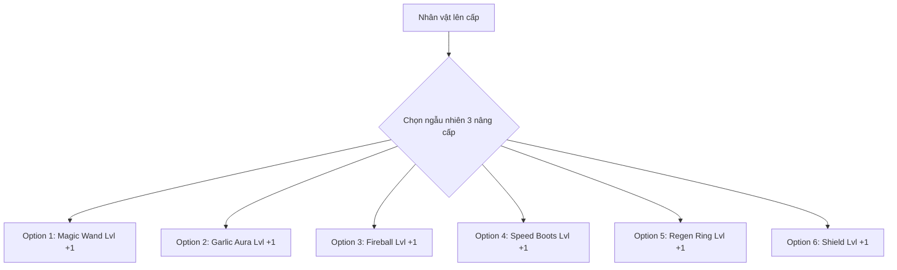

# Thiết Kế Hệ Thống Nâng Cấp Đa Dạng (Pixel Survivors)

Để game trở nên cuốn hút và có chiều sâu chiến thuật như *Vampire Survivors*, chúng ta đã tích hợp một hệ thống nâng cấp đa dạng kết hợp giữa **Vũ khí chủ động (Weapons)** và **Trang bị bị động (Passives)**.

Khi người chơi lên cấp, game sẽ chọn ngẫu nhiên 3 trong số các nâng cấp dưới đây để người chơi lựa chọn.

---

## ⚔️ 1. Vũ Khí Chủ Động (Active Weapons)

Người chơi có thể sở hữu đồng thời nhiều loại vũ khí. Chúng sẽ tự động tấn công theo chu kỳ độc lập.

| Tên Vũ Khí | Biểu tượng hình ảnh | Mô tả cơ chế hoạt động | Các cấp nâng cấp (Max Lvl 5) |
| :--- | :--- | :--- | :--- |
| **Magic Wand** *(Trượng Phép)* | Tia sét màu vàng (Mặc định có sẵn) | Tự động bắn tia phép vào kẻ địch gần nhất. | **Lvl 1**: Bắn 1 tia phép. **Lvl 2**: Tăng 20% sát thương. **Lvl 3**: Bắn thêm +1 tia phép cùng lúc. **Lvl 4**: Giảm 20% thời gian chờ bắn. **Lvl 5**: Tia phép có khả năng xuyên thấu 1 quái vật. |
| **Garlic Aura** *(Hào Quang Tỏi)* | Vòng tròn màu trắng xung quanh người | Tạo vòng hào quang bảo vệ quanh Player. Quái vật bước vào vòng sẽ bị giật sát thương liên tục theo thời gian. | **Lvl 1**: Gây sát thương nhỏ mỗi 0.5 giây trong phạm vi hẹp. **Lvl 2**: Tăng 20% bán kính vòng bảo vệ. **Lvl 3**: Tăng 30% sát thương gây ra. **Lvl 4**: Đẩy lùi quái vật nhẹ khi chúng chạm vào vòng. **Lvl 5**: Tăng gấp đôi sát thương. |
| **Fireball** *(Quả Cầu Lửa)* | Khối tròn màu cam đỏ | Bắn quả cầu lửa khổng lồ bay ngẫu nhiên, di chuyển chậm nhưng gây sát thương diện rộng và xuyên qua nhiều kẻ địch. | **Lvl 1**: Bắn 1 quả cầu lửa xuyên thấu tối đa 3 quái. **Lvl 2**: Tăng tốc độ bay của cầu lửa. **Lvl 3**: Tăng sát thương diện rộng (+40%). **Lvl 4**: Cầu lửa nổ khi hết thời gian, gây sát thương lan. **Lvl 5**: Bắn 2 quả cầu lửa cùng lúc theo các hướng ngẫu nhiên. |

---

## 🛡️ 2. Trang Bị Bị Động (Passive Items)

Tự động tăng chỉ số hoặc cung cấp hiệu ứng hỗ trợ cho Player.

| Tên Trang Bị | Cơ chế hỗ trợ | Các cấp nâng cấp (Max Lvl 5) |
| :--- | :--- | :--- |
| **Speed Boots** *(Giày Thần Tốc)* | Tăng tốc độ chạy của nhân vật chính. | **Mỗi cấp**: Tăng +15% tốc độ chạy cơ bản (Cộng dồn tối đa +75%). |
| **Regen Ring** *(Nhẫn Hồi Phục)* | Tự động hồi phục sinh lực theo thời gian. | **Lvl 1**: Hồi 1 HP mỗi 2 giây. **Lvl 2**: Hồi 1 HP mỗi 1 giây. **Lvl 3**: Hồi 2 HP mỗi 1 giây. **Lvl 4**: Hồi 3 HP mỗi 1 giây. **Lvl 5**: Hồi 5 HP mỗi 1 giây. |
| **Shield** *(Giáp Phản Đòn)* | Giảm sát thương nhận vào từ va chạm quái vật và phản lại một lượng sát thương nhỏ. | **Lvl 1**: Giảm 10% sát thương nhận vào. **Lvl 2**: Giảm 20% sát thương nhận vào. **Lvl 3**: Giảm 30% sát thương nhận vào. **Lvl 4**: Phản lại 15% sát thương nhận vào lên quái. **Lvl 5**: Giảm 40% sát thương, phản lại 30% sát thương. |

---

## 🎨 Trực Quan Hóa Hệ Thống Nâng Cấp

---

> [!NOTE]
> **Cách thức hoạt động trong game:**
> - Khi bạn lên cấp (Level Up), trò chơi sẽ tạm dừng.
> - Hệ thống sẽ quét cấp độ hiện tại của các vũ khí/trang bị mà người chơi đang sở hữu, lấy ra 3 nâng cấp hợp lệ (chưa đạt cấp tối đa Lvl 5) và hiển thị lên màn hình.
> - Người chơi sử dụng phím `1`, `2`, `3` tương ứng để lựa chọn.
